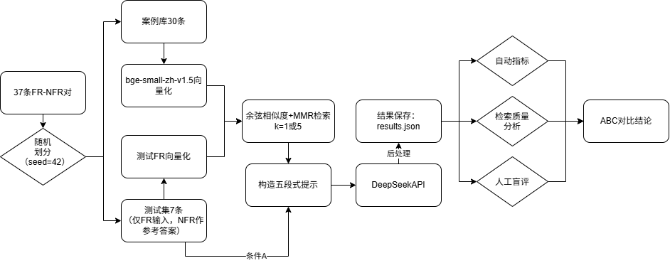

# LLM-NFR-Generation: 基于大语言模型与 RAG 的非功能需求生成


本项目是对《基于大语言模型的非功能需求生成方法》（欧阳柳波等，软件学报）的小规模复现与实践。旨在利用大语言模型（LLM）与检索增强生成（RAG）技术，解决传统非功能需求（NFR）获取效率低、大模型直接生成易产生“幻觉”及缺乏专业性的问题。

[点击这里查看完整实验报告 (PDF)](./大模型非功能需求生成方法报告.pdf) 

## 核心特性

- **结构化案例库**：基于 37 条 FR-NFR 对构建知识库，按 8:2 划分训练集与测试集。
- **语义检索与 MMR**：使用 `bge-small-zh-v1.5` 生成向量，结合最大边际相关性（MMR）算法检索历史相似案例，兼顾相关性与多样性。
- **五段式提示工程**：设计包含“角色定位、任务背景、分析步骤、输出格式、情感激励”的专业 Prompt。
- **多维度评估**：结合自动指标（BLEU、ROUGE、可量化比例、类别覆盖）与双人匿名盲评（完整性、准确性、可测试性）。

## 实验架构



## 目录结构

```text
├── data/                   # 数据集目录
│   ├── data.json           # 原始 37 条 FR-NFR 数据
│   └── prompts.json        # 构造好的 A/B/C 提示词
├── src/                    # 源代码目录
│   ├── create_data.py      # 生成初始数据
│   ├── step1_retrieve.py   # 检索与 MMR 算法
│   ├── step2_generate.py   # 调用 DeepSeek 批量生成
│   ├── step3_evaluate.py   # 自动指标评估
│   └── make_blind_review.py# 生成人工盲评材料
├── results/                # 实验结果目录
│   ├── eval_report_fixed.md# 最终自动评估报告
│   └── blind_review_*.xlsx # 双人盲评打分表
└── assets/                 # 资源文件（流程图等）
```

## 快速开始

### 1. 环境准备

```bash
# 克隆项目
git clone https://github.com/wen-yan-chen/LLM-nfr-generation.git
cd LLM-nfr-generation

# 安装依赖
pip install -r requirements.txt
```

### 2. 配置 API Key

本项目使用 DeepSeek API 进行生成，请配置环境变量：

```bash
# Windows PowerShell
$env:DEEPSEEK_API_KEY="sk-你的API_KEY"
# Linux / macOS
export DEEPSEEK_API_KEY="sk-你的API_KEY"
```

### 3. 运行流水线

```bash
python src/create_data.py
python src/step1_retrieve.py
python src/step2_generate.py
python src/step3_evaluate.py
python src/make_blind_review.py
```

## 实验结果摘要

实验设置了三种条件：

- A（无检索基线）：直接让 LLM 生成 NFR。
- B（Top-1 检索）：注入 1 条相似历史案例。
- C（MMR Top-5 检索）：注入 5 条具有多样性的历史案例。

核心结论：

- 检索质量：MMR top5 检索的高+中相关案例占比 57.1%，整体可用。
- 自动指标：C 条件在可量化比例（0.8784）、BLEU（0.0393）与 ROUGE-L（0.1140）上均为最优。A 条件生成的 NFR 条数最多，但可量化比例最低，包含较多泛泛表述。
- 人工盲评：C 条件总平均 4.33 分（满分 5 分）为三者最高且最均衡。相比 A，C 的准确性提升；相比 B，C 的完整性提升。

(详细数据分析与局限性讨论请参阅 PDF 报告或 results/ 目录下的 Markdown 文件)

## 引用

如果你觉得这个项目对你有帮助，欢迎 Star！

原始论文：

欧阳柳波, 叶巧莹, 孟心如, 杜漫茹. 基于大语言模型的非功能需求生成方法. 软件学报. http://www.jos.org.cn/1000-9825/7557.htm

## License

This project is licensed under the MIT License.

---

### 上传后的检查清单：

1. 粘贴保存后，确保仓库首页的流程图（`assets/flowchart.png`）能正常显示。
2. 如果提示 PDF 链接 404，说明你还没把 PDF 传上去，记得在根目录上传一个叫 `Report.pdf` 的文件。
3. 看看右上角的 `About` 设置里的 Description 和 Topics 填了没。
